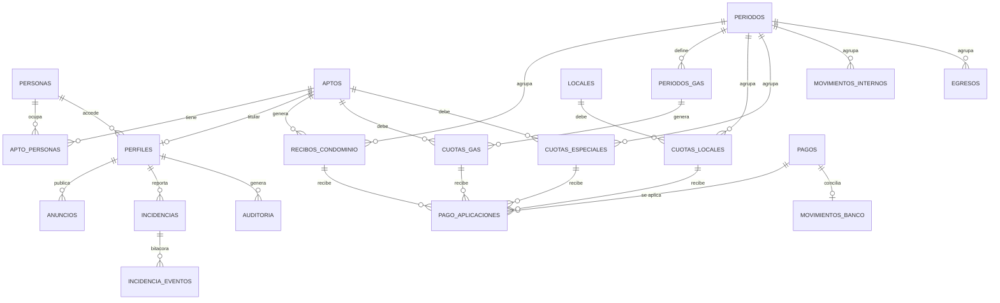

# LUMA — Documento maestro del proyecto

> **Documento canónico.** Este archivo contiene la versión consolidada y vigente del alcance, los requisitos, las reglas de negocio, las decisiones, la arquitectura, el modelo de datos y el plan de trabajo. Los demás documentos de `documentacion/Docs/` se conservan como fuentes de trabajo e insumos históricos.

| Campo | Valor |
|---|---|
| Proyecto | **LUMA** — Sistema de información web para la gestión comunicacional, de incidencias y de cobranza |
| Comunidad | Conjunto Residencial La Churuata, Torre 4 — RIF J-31119491-6 |
| Ubicación | Carrera Milán, Parque Residencial Churuata, Pdo. Caroní, Estado Bolívar |
| Programa | Servicio Comunitario UNEG — Ingeniería Informática, Sede Puerto Ordaz |
| Duración | 120 horas · 03/07/2026 – 30/10/2026 |
| Equipo | Daniel Villalba Santamaría (27.506.542) · Isabella Rodríguez (31.521.612) · Luis Millán (30.040.213) |
| Asesores | Académico: Prof. Germain Salazar Yépez · Comunitario: Lcda. Jheizzi Bethermy |
| Documento | `documentacion/Docs/LUMA.md` |
| Versión | **1.0** |
| Fecha | 21/10/2026 |
| Estado | **Consolidado para validación** |

## Historial de versiones

| Versión | Fecha | Cambio |
|---|---|---|
| 1.0 | 21/10/2026 | Consolidación inicial: alcance, 57 RF, 24 RNF, 52 preguntas, decisiones D-01 a D-20, arquitectura Opción B, modelo de datos y plan por fases |

---

## 1. Resumen ejecutivo

LUMA es una aplicación web responsive (PWA) que sustituye el manejo manual en Excel y los grupos de WhatsApp de la Torre 4. Se organiza en dos bloques:

1. **Gestión comunicacional e incidencias:** cartelera digital, recibos, normativas y reporte de averías con seguimiento.
2. **Gestión financiera y de cobranza:** padrón, cobranza de condominio por alícuota, cuota de gas, locales comerciales con cuenta propia, cuotas especiales, ingresos/egresos, conciliación bancaria y reportes.

**Datos maestros:** 101 apartamentos (96 de 12 pisos + 5 en planta baja), 5 locales comerciales, 58 apartamentos con servicio de gas, dos alícuotas fijas y base histórica de julio 2026.

**Estado real:** documentación consolidada y decisiones de negocio cerradas en su mayoría; **la implementación de software no ha comenzado**. El stack está definido y el modelo de datos está especificado en este documento.

**Stack:** Next.js (App Router) + TypeScript + Tailwind CSS + shadcn/ui + Supabase (PostgreSQL, RLS, Storage) + Vercel, con exportación a Excel/PDF mediante `xlsx`.

---

## 2. Problema y objetivos

### 2.1 Problema

La Junta de Condominio de la Torre 4 gestiona la comunicación con carteleras físicas desactualizadas y grupos de WhatsApp saturados, y reporta las averías de forma informal. La cobranza (condominio, gas y locales), la verificación de comprobantes y los ingresos/egresos se manejan manualmente en Excel, con dificultad para conciliar contra los estados de cuenta, sin histórico estructurado y con desconfianza creciente de los vecinos.

**Causas:** dependencia de métodos manuales y ausencia de herramientas tecnológicas formales adaptadas a la administración comunitaria.

**Consecuencias:** pérdida de información, retrasos en reparaciones, descontrol de la recaudación y malestar de los vecinos.

### 2.2 Objetivo general

Implementar un sistema de información web para la gestión comunicacional y el control de incidencias y cobranza del Conjunto Residencial La Churuata, Torre 4.

### 2.3 Objetivos específicos

1. Diagnosticar los requerimientos funcionales y tecnológicos de la Junta y los residentes.
2. Diseñar la arquitectura de software e interfaces adaptadas a dispositivos móviles.
3. Desarrollar los módulos de cartelera digital, reporte de averías y control de recaudación.
4. Capacitar a la comunidad para administrar y usar el sistema de forma autónoma.

> **Nota de alcance:** el título original del anteproyecto menciona "gestión comunicacional y control de incidencias". La elicitación amplió el alcance al control de cobranza e ingresos/egresos, que es el núcleo funcional real del sistema. Esta ampliación queda documentada en la sección 3.

---

## 3. Alcance

### 3.1 Módulos incluidos

| # | Módulo | Incluye | Prioridad |
|---|---|---|---|
| 1 | Usuarios y acceso | Registro, autenticación por cédula, roles, asociación propietario–apartamento | MVP |
| 2 | Padrón | 101 apartamentos, propietarios, inquilinos como contacto, locales y contratos | MVP |
| 3 | Cartelera digital | Anuncios, normativas, notas del recibo, lectura para vecinos | MVP |
| 4 | Reporte de averías | Envío con foto, anonimato opcional, asignación, estados y bitácora | MVP |
| 5 | Cobranza de condominio | Cuota por alícuota, recibos, pagos, saldos, impagos y extemporáneos | MVP |
| 6 | Cuota de gas | 58 usuarios, modalidad configurable por periodo, pagos y pago al proveedor | MVP |
| 7 | Locales comerciales | Cuenta propia, cuotas en USD, ingresos/egresos y contratos | MVP |
| 8 | Ingresos/egresos y conciliación | Clasificación por cuenta, egresos fijos/variables, conciliación bancaria | MVP (automática: fase 2) |
| 9 | Reportes y consultas | Relación de cobranza, saldos, ingresos/egresos y exportación | MVP |
| 10 | Mensajes, notas y observaciones | Espacio por apartamento y avisos generales | MVP |
| 11 | Cuotas especiales y movimientos internos | Impermeabilización, compra de divisa y ajustes aprobados | MVP |

### 3.2 Alcance de datos (carga inicial)

- Cobranza y saldos por apartamento desde la *Relación de Cobranzas* de **junio 2026** (`1.jpg`, `2.jpg`). No hay reporte de cobranza de julio en los escaneos.
- Pagos de gas de **julio 2026** (`3.jpg`).
- Ingresos y egresos de locales de **julio 2026** (`4.jpg`, "Base de datos ③").
- Egresos imputables al condominio de **julio 2026** (`5.jpg`).
- Relación de ingresos y egresos en Bs. de **julio 2026** (`6.jpg`).
- Egresos de cuentas bancarias de **julio 2026** (`7.jpg`).
- Nota manuscrita de contacto y tareas legales (`7reverso.jpg`).
- Padrón de apartamentos y locales con alícuotas y contratos.
- **Periodo base:** junio–julio 2026 (cobranza de junio; gas, locales, egresos e ingresos de julio), extensible hacia atrás según los históricos disponibles.

### 3.3 Actores

- Junta Directiva / Administración.
- Propietarios de la Torre 4 (consulta, pago, reporte). **Solo el propietario tiene cuenta** (D-09).
- 5 locales comerciales (cuota y cuenta propia), administrados por la Junta; no tienen login propio (D-10).
- Contador externo / asesor comunitario (solo lectura financiera).

### 3.4 Exclusiones

| # | Exclusión | Motivo |
|---|---|---|
| E-01 | Pasarelas de pago o integraciones bancarias automáticas | Los pagos siguen siendo transferencia/efectivo validados por la Junta |
| E-02 | Nómina, contabilidad fiscal y emisión de facturas | Función del contador externo |
| E-03 | Aplicación nativa iOS/Android | Se usa web responsive/PWA |
| E-04 | Telemetría de ascensores, cámaras o accesos | Solo se reportan incidencias |
| E-05 | Estacionamiento, áreas comunales o reservas | No solicitado |
| E-06 | Otras torres o condominios | Solo Torre 4; escalabilidad futura |
| E-07 | Medidores individuales de agua/gas | El agua no llega a todos; el gas se cobra por cuota de edificio |
| E-08 | Portal de quejas anónimas o libro de reclamos formal | El reporte de averías es el canal previsto |
| E-09 | Reemplazo total de Excel a corto plazo | Se conserva exportación a Excel/PDF |
| E-10 | Votaciones o asambleas electrónicas | Se rige por la Ley de Propiedad Horizontal |

### 3.5 Supuestos

1. La Junta provee los Excel históricos o, en su defecto, se transcriben los JPG (D-19).
2. `admn.churuatatorre4@gmail.com` se mantiene como canal oficial de comprobantes durante la transición.
3. Los vecinos cuentan con internet y celular; la encuesta formal no se aplicó (P-49).
4. La alícuota es fija y la cuota mensual se calcula con los egresos del mes (provisional, D-04/D-12).
5. El hosting se mantiene en planes gratuitos: Supabase Free + Vercel Hobby (D-11).
6. Las cuentas de servicios quedan a nombre de los estudiantes con traspaso formal antes de la entrega (D-18).

### 3.6 Dependencias

| Dependencia | Responsable | Impacto si falla |
|---|---|---|
| Excel históricos o transcripción de JPG | Junta / equipo | No se puede cargar el histórico (RF-30) |
| Confirmación de reglas de cobro y gas | Junta + contadora | Bloquea el cierre definitivo de RF-19 a RF-35 |
| Respuestas a las 8 preguntas abiertas | Junta / contadora | Afecta reportes y clasificación de egresos |
| Cuentas Supabase/Vercel/GitHub | Equipo | Bloquea despliegue y traspaso |
| Capacitación y acta de aceptación | Equipo + Junta | Afecta la adopción y el cierre formal |

### 3.7 Criterios de éxito

- Plataforma web operativa y accesible para la Torre 4.
- Centralización de anuncios, recibos y normativas.
- Registro de incidencias con seguimiento transparente.
- Control de cobranza e impagos con histórico y conciliación.
- Capacitación de la Junta para administrar el sistema de forma autónoma.
- Reducción del papel y de la dependencia de WhatsApp.

### 3.8 Restricciones

- **Duración académica:** 120 horas / 15 semanas (03/07/2026 – 30/10/2026).
- **Equipo:** 3 estudiantes, asesor académico y asesora comunitaria.
- **Presupuesto:** sin infraestructura paga; solo laptops, celulares, internet y papelería.
- **Usabilidad:** interfaz en español, mobile-first y apta para baja alfabetización digital.
- **Punto de partida:** basarse en los reportes existentes y crear primero el histórico.

---

## 4. Actores, roles y permisos

| Rol | Descripción | Permisos |
|---|---|---|
| `ADMIN` | Junta / Administración | Gestión total: padrón, cobranza, gas, locales, egresos, cartelera, averías, usuarios y reportes |
| `VECINO` | Propietario titular de un apartamento | Consulta su apartamento, recibo, saldo e histórico; registra pagos y averías; lee cartelera |
| `CONTADOR` | Contador externo / auditor | Solo lectura de estados financieros y reportes; exportación |
| Público (sin sesión) | Visitante | Cartelera publicada y estado público de incidencias sin datos del reportante |

**Reglas de identidad:**

- Un apartamento tiene **un propietario titular con cuenta** (D-09).
- El inquilino y otros familiares se registran como contactos, sin acceso al sistema.
- La autenticación usa **cédula + contraseña**; Supabase Auth se alimenta con un correo sintético interno.
- El contador no modifica datos.
- Los locales no tienen rol propio; el administrador gestiona su cuenta y su encargado es un dato de contacto.

---

## 5. Requisitos funcionales

**Convención:** `RF-xx` funcional · `M` MVP · `A` alto · `F` futuro.

### A. Usuarios y acceso

| ID | Requisito | Prioridad |
|---|---|---|
| RF-01 | Registrar, editar y desactivar usuarios con rol `ADMIN`, `VECINO` o `CONTADOR` | M |
| RF-02 | Autenticar con cédula y contraseña; cierre de sesión; reseteo de contraseña asistido por el administrador | M |
| RF-03 | Asociar un propietario titular por apartamento; registrar inquilinos y contactos sin acceso; asociar locales a un encargado | M |
| RF-04 | Control de acceso por rol: el vecino solo ve y opera sobre su apartamento; la Junta ve todos | M |
| RF-05 | Registrar actividad básica de acceso (quién y cuándo) | F |

### B. Padrón

| ID | Requisito | Prioridad |
|---|---|---|
| RF-06 | Mantener 101 apartamentos: código, piso, tipo (apartamento/planta baja), con/sin balcón, alícuota y estado (ocupado/vacío) | M |
| RF-07 | Mantener propietario e inquilino/contacto por apartamento: nombre, cédula, teléfono y correo opcional | M |
| RF-08 | Mantener el catálogo de 5 locales: nombre, contrato (inicio/fin, 1 año), cuota USD, encargado y estado de adeudo | M |
| RF-09 | Diferenciar parámetros de cobro por concepto: condominio, gas, local y cuotas especiales | M |

### C. Cartelera digital

| ID | Requisito | Prioridad |
|---|---|---|
| RF-10 | La Junta crea, edita, publica y archiva anuncios con título, cuerpo, fecha y adjunto opcional | M |
| RF-11 | Vista de lectura para vecinos con histórico de anuncios y normativas vigentes | M |
| RF-12 | Publicación del recibo mensual y de notas/observaciones dirigidas a la comunidad | A |
| RF-13 | Notificación a los vecinos cuando se publica un anuncio nuevo | F |

### D. Reporte de averías

| ID | Requisito | Prioridad |
|---|---|---|
| RF-14 | El vecino reporta una avería con categoría libre, ubicación, descripción, foto opcional y anonimato opcional | M |
| RF-15 | La Junta asigna responsable/proveedor y cambia el estado: `Pendiente → En proceso → Resuelto → Cerrado` | M |
| RF-16 | Historial y bitácora de cada incidencia con fechas, observaciones y autor | M |
| RF-17 | Consulta pública del estado de las incidencias sin datos del reportante | A |
| RF-18 | Notificación al reportante al cambiar el estado | F |

### E. Cobranza de condominio

| ID | Requisito | Prioridad |
|---|---|---|
| RF-19 | Definir por periodo los egresos imputables al recibo y calcular la cuota por apartamento = alícuota × egresos del mes en USD | M |
| RF-20 | Generar el recibo por apartamento y periodo con saldo anterior, cuota del mes, ajustes y saldo actual | M |
| RF-21 | Registrar pagos con apartamento, concepto, monto, moneda, tasa BCV aplicada, referencia, fecha y comprobante | M |
| RF-22 | Soportar varias referencias por pago, referencias compartidas entre apartamentos y cruce de cuentas | M |
| RF-23 | Registrar pagos en efectivo con validación manual de la Junta | M |
| RF-24 | Calcular y mostrar el saldo actual por apartamento; saldo negativo = crédito a favor | M |
| RF-25 | Clasificar los pagos como del mes o extemporáneos (deuda de meses anteriores) | M |
| RF-26 | Registrar abonos en cuotas y pagos por adelantado | A |
| RF-27 | Aplicar descuentos por servicios prestados al condominio, con motivo y aprobación del administrador | A |
| RF-28 | Registrar y conciliar pagos devueltos/rechazados anulando el original y revirtiendo el saldo | A |
| RF-29 | Reporte de impagos por apartamento y por concepto | M |
| RF-30 | Cargar el histórico inicial desde los reportes: saldo anterior, pagos, referencias, tasas y fechas | M |

### F. Cuota de gas

| ID | Requisito | Prioridad |
|---|---|---|
| RF-31 | Registrar los 58 apartamentos con servicio de gas y excluir a los demás del cobro | M |
| RF-32 | Definir por periodo la modalidad de gas: cuota fija USD, consumo del edificio prorrateado o monto manual | M |
| RF-33 | Registrar pagos de gas con referencia, fecha, efectivo y clasificación banco/efectivo/cuenta por cobrar | M |
| RF-34 | Registrar el pago al proveedor (factura, litros, precio/litro, flete, total) y compararlo con lo recaudado | A |
| RF-35 | Reporte mensual de gas por apartamento con totales banco + efectivo + pendiente | M |

### G. Locales comerciales

| ID | Requisito | Prioridad |
|---|---|---|
| RF-36 | Registrar los ingresos de alquiler de locales en la cuenta propia (eventos), excluidos del recibo de condominio | M |
| RF-37 | Registrar la cuota mensual por local en USD, su conversión, encargado y estado de adeudo | M |
| RF-38 | Registrar egresos de la cuenta de locales y clasificar cuáles se imputan al condominio y cuáles no | M |
| RF-39 | Controlar vencimiento de contratos (1 año) y el pago dentro de los primeros 5 días del mes | A |
| RF-40 | Resumen mensual de ingresos y egresos de locales con saldo inicial y final | M |

### H. Ingresos, egresos y conciliación

| ID | Requisito | Prioridad |
|---|---|---|
| RF-41 | Registrar egresos con descripción, fecha, factura, monto Bs, tasa, monto USD y tipo fijo/variable | M |
| RF-42 | Clasificar cada movimiento por cuenta: condominio, locales (0908) o gas | M |
| RF-43 | Registrar ingresos bancarios por concepto y otros ingresos en efectivo | M |
| RF-44 | Conciliar los registros internos con el estado de cuenta importado y marcar coincidencias/diferencias | A |
| RF-45 | Mostrar el saldo real disponible de la última fila del estado de cuenta | M |
| RF-46 | Registrar pagos recibidos en cuentas personales de administradores y su traslado posterior | A |
| RF-47 | Generar estados financieros mensuales: ingresos/egresos en Bs y USD, fijos/variables y totales por cuenta | M |

### I. Reportes y consultas

| ID | Requisito | Prioridad |
|---|---|---|
| RF-48 | Relación de cobranza mensual por apartamento con saldo anterior, cuota, pagos, referencia, tasa, fecha y saldo actual, más cierres | M |
| RF-49 | Consulta de saldo e histórico de movimientos de un apartamento en cualquier periodo | M |
| RF-50 | Reportes de ingresos/egresos por periodo y por cuenta | M |
| RF-51 | Exportación de reportes a Excel/PDF | A |
| RF-52 | Tablero resumen para la Junta: recaudación, incumplimientos e incidencias abiertas | F |

### J. Mensajes, notas y observaciones

| ID | Requisito | Prioridad |
|---|---|---|
| RF-53 | Espacio de mensajes/notas por apartamento y periodo, visible para la Junta | M |
| RF-54 | Publicar observaciones generales en el recibo/cartelera | M |

### K. Cuotas especiales y movimientos internos

| ID | Requisito | Prioridad |
|---|---|---|
| RF-55 | Registrar cuotas especiales por apartamento (ej. impermeabilización) con concepto, monto, aprobación y estado | M |
| RF-56 | Registrar movimientos internos (ej. compra de divisa) sin afectar el recibo de condominio | M |
| RF-57 | Mantener una bandeja de pagos bancarios sin asignar para referencias no reportadas (ej. Ref. 668374) | A |

---

## 6. Requisitos no funcionales

| ID | Categoría | Requisito |
|---|---|---|
| RNF-01 | Usabilidad | Interfaz mobile-first y responsive, usable desde celular |
| RNF-02 | Usabilidad | Sin conocimientos técnicos; apta para baja alfabetización digital; 100 % en español |
| RNF-03 | Usabilidad | Acciones clave (pagar, reportar, consultar saldo) en ≤ 3 clics |
| RNF-04 | Disponibilidad | ≥ 99 % con acceso continuo desde internet (24/7) |
| RNF-05 | Rendimiento | Páginas principales en < 3 s sobre 4G |
| RNF-06 | Rendimiento | Soportar ~100 usuarios concurrentes y 101 apartamentos + 5 locales sin degradación |
| RNF-07 | Seguridad | Contraseñas con hash, sesión con expiración y bloqueo por intentos fallidos |
| RNF-08 | Seguridad | Autorización estricta por rol; el vecino nunca accede a datos de otros apartamentos |
| RNF-09 | Seguridad | Protección de datos personales (cédula, teléfono, correo) y de la información financiera |
| RNF-10 | Integridad | Valores monetarios con 2 decimales; precisión en tasas y alícuotas |
| RNF-11 | Integridad | Concurrencia controlada en el registro de pagos; sin duplicados |
| RNF-12 | Trazabilidad | Autor y fecha en cambios de pagos, egresos, ajustes y estados de incidencias |
| RNF-13 | Respaldo | Copias de seguridad automáticas y recuperación verificable |
| RNF-14 | Confiabilidad | Los cuadres de cobranza, gas, locales e ingresos/egresos reproducen los reportes Excel |
| RNF-15 | Portabilidad | Despliegue web con URL pública, sin instalación en equipos del condominio |
| RNF-16 | Compatibilidad | Chrome, Edge, Safari y Firefox actuales en iOS y Android |
| RNF-17 | Mantenibilidad | Código estructurado por módulos y documentado para continuidad |
| RNF-18 | Legal | Alineado con la Ley de Propiedad Horizontal y las reglas internas |
| RNF-19 | Legal | Observancia de la Ley del Servicio Comunitario (Gaceta Nº 38.272) |
| RNF-20 | Capacitación | Manual Rápido de Usuario digital y sesiones de capacitación |
| RNF-21 | Escalabilidad | Arquitectura que permita incorporar otras torres/condominios sin rediseño mayor |
| RNF-22 | Offline | Lectura offline de últimos recibos, saldos y anuncios; escrituras financieras requieren conexión |
| RNF-23 | Traspaso | Documentación, credenciales y respaldos transferibles a la Junta al cierre |
| RNF-24 | Datos | Exportación completa y restauración verificable de la base de datos |

---

## 7. Reglas de negocio

| # | Regla | Estado | Fuente |
|---|---|---|---|
| R1 | Condominio y gas son conceptos distintos y se pagan por separado | Cerrada | Reunión día 1; F9 |
| R2 | Cuota de condominio = alícuota del apartamento × egresos imputables del mes en USD | **Provisional** | Verificación aritmética; D-12 |
| R3 | Alícuota fija: con balcón (impares) 0,998545 %; sin balcón (pares y PB) 0,982140 % | Cerrada | D-02 |
| R4 | Cada pago guarda la tasa BCV del día del pago | Cerrada | P-12 |
| R5 | Saldo actual = saldo anterior + cuota − pagos; negativo = crédito a favor | **Provisional** | D-04, D-12 |
| R6 | Las deudas admiten abonos en cuotas y pagos por adelantado | Cerrada | P-18 |
| R7 | El pago posterior a la fecha límite se clasifica como extemporáneo | Cerrada | R7, P-14 |
| R8 | Los ingresos de locales van a la cuenta 0908 (eventos) y nunca al recibo de condominio | Cerrada | R8 |
| R9 | Los egresos de locales requieren clasificación explícita: imputados o no al condominio | Cerrada | R9 |
| R10 | Los registros internos deben conciliarse con el estado de cuenta bancario | Cerrada | R10 |
| R11 | Un pago devuelto se anula y se revierte el saldo; no se crea un movimiento negativo nuevo | Cerrada | P-17 |
| R12 | Un residente que presta un servicio puede recibir descuento aprobado por la administración | Cerrada | P-10, P-19 |
| R13 | El gas solo se cobra a los 58 apartamentos con servicio; los blancos de la lista son impagos | Cerrada | P-22 |
| R14 | Los locales pagan dentro de los primeros 5 días y sus ingresos van a su cuenta | Cerrada | R14 |
| R15 | Referencias sin fecha visible o tardías requieren validación manual y observación | Cerrada | P-15, P-16 |
| R16 | El saldo real de la cuenta es el de la última fila del estado de cuenta | Cerrada | R16 |
| R17 | Egresos fijos y variables se reportan en Bs y USD con su tasa | Cerrada | R17 |
| R18 | Mora del condominio a los 15 días de emitido el recibo; el gas lo define el administrador | Cerrada | P-14 |
| R19 | Impermeabilización = cuota especial; compra de divisa = movimiento interno | Cerrada | P-29 |
| R20 | En la vista pública de morosidad solo se muestra número de apartamento y monto | Cerrada | P-42 |
| R21 | La modalidad de gas se define por periodo (fija, consumo prorrateado o manual) | Cerrada | D-08 |
| R22 | Los periodos cerrados no admiten edición retroactiva sin reapertura auditada | Técnica | T-01 |

### 7.1 Verificación aritmética de julio 2026

| Conjunto | Cuadre | Resultado |
|---|---|---|
| Cobranza **junio** | 753.635,90 = 669.329,54 (banco) + 6.500,00 (efectivo) + 6.333,60 (cruce) + 71.472,76 (extemporáneo) | ✔ |
| Gas **julio** | 223.512,85 = 214.822,82 (banco) + 4.300,00 (efectivo) + 4.390,03 (cuenta por cobrar) | ✔ |
| Ingresos **julio** | 50.861,41 + 669.329,54 + 214.822,82 + 119.790,84 = 1.054.804,61 (bancarios) · + 17.133,60 (otros) = 1.071.938,21 | ✔ |
| Alícuota **julio** | 1.088,03 USD × 0,982140 % = 10,69 · × 0,998545 % = 10,86 | ✔ |
| Egresos **julio** | Recibo 1.088,03 USD vs banco 995.391,42 Bs vs relación ≈ 709.599,72 Bs | Provisional (D-05) |

> **Corrección de periodo:** `1.jpg` y `2.jpg` corresponden a **junio 2026** (cuotas 9,49/9,34), no a julio. Los documentos previos etiquetaron esa cobranza como "julio" y desplazaron el mapeo de los escaneos. `LUMA.md` adopta el periodo real de cada reporte.

> **Conciliación de la transcripción (cobranza junio):** verificadas las 100 filas contra `1.jpg` y `2.jpg`, los pagos en Bs cuadran exactamente con el total impreso (**753.635,90**) y la cuota en USD con **964,43**. Se corrigieron: apto 21 (cuota Bs `6.707,91`, pagos `6.738,00`, ref. `936340`, tasa `700,22`), apto 22 (pagos `6.738,00`), apto 77 (tasa vacía), apto 105 (cuota y saldo `0,00`) y apto 125 (cuota `9,49`). Las diferencias restantes provienen del reporte, no de la transcripción: saldo anterior sumado **1.627,92** vs. impreso **1.594,22** (+33,70; cada celda coincide con el escaneo), pagos USD **991,07** vs. **991,09** (−0,02) y saldo actual **1.598,67** vs. **1.598,66** (+0,01). El **extemporáneo** impreso (**71.472,76**) no se reproduce por fecha: se clasificó provisionalmente julio → `banco` (**658.073,86**) y agosto → `extemporaneo` (**82.728,44**); la diferencia simétrica de **11.255,68** corresponde al corte entre recibos y banco y queda pendiente de la contadora (P-09; ver §8.2 V-01). El apto 67 no aparece en la relación de cobranza.

---

## 8. Preguntas y dudas consolidadas

**Estados:** `Cerrada` · `Provisional` (se implementa y se valida) · `Condicional` (requiere seguimiento) · `Abierta` (no bloqueante).

> **Registro único:** la versión operativa completa, con las respuestas de la contraparte y el seguimiento V-01 a V-10, está en [`Preguntas y Dudas.md`](Preguntas y Dudas.md).

| ID | Pregunta | Respuesta / decisión | Estado |
|---|---|---|---|
| P-01 | ¿Cuántos apartamentos son? | 101: 8 por piso × 12 + 5 en planta baja; el "91" inicial se descarta | Cerrada |
| P-02 | ¿Cuota = alícuota × egresos del mes? | Verificada aritméticamente; falta firma de la contadora | Provisional |
| P-03 | ¿Alícuota fija o recalculada? | Fija y constante por apartamento | Cerrada |
| P-04 | ¿Impares con balcón? ¿PB? | Impares con balcón; pares y toda la PB sin balcón | Cerrada |
| P-05 | ¿Vacíos pagan? | Sí, sin exenciones | Cerrada |
| P-06 | Montos atípicos en la cuota (aptos 48, 105, 106, 121) | Se registran como ajuste con motivo; validar con la contadora | Abierta |
| P-07 | Dos reportes de egresos que no cuadran | Recibo = gastos imputables; banco = flujo real (gas, ascensor 0908, cuenta por cobrar) | Provisional |
| P-08 | ¿Saldo negativo? | Crédito a favor; ajuste de centavos según validación | Provisional |
| P-09 | ¿Extemporáneo en el mismo mes? | Se pagó aparte; clasificación provisional por fecha (julio → banco, agosto → extemporáneo) y corte de 11.255,68 Bs pendiente de confirmar (V-01) | Condicional |
| P-10 | ¿Cruce de cuentas es descuento? | Sí: descuento por reparación/servicio de un residente | Cerrada |
| P-11 | ¿Cuenta por cobrar administración? | Sin respuesta; la arquitectura la vincula a la Ref. 877422 del 08/08/2026 | Abierta |
| P-12 | ¿Tasa promedio o tasa del día? | Tasa BCV del día del pago, guardada por transacción | Cerrada |
| P-13 | Referencia 668374 no reportada | Bandeja de pagos por validar; puede no reflejarse | Condicional |
| P-14 | Fecha límite y mora | Condominio: 15 días; gas: la define el administrador | Cerrada |
| P-15 | Pago sin fecha visible | Se confirma y se registra la fecha real del pago | Cerrada |
| P-16 | Referencias fuera de plazo o cuentas personales | Se guarda la referencia y se confirma manualmente | Cerrada |
| P-17 | Pago devuelto | Se anula el original y se revierte el saldo | Cerrada |
| P-18 | ¿Abonos en cuotas? | Sí, se permiten | Cerrada |
| P-19 | ¿Quién aprueba descuentos? | La administración | Cerrada |
| P-20 | ¿Gas fijo o por consumo? | Modalidad configurable por periodo | Cerrada |
| P-21 | "CON APTO 28" / "CON CONDOMINIO" | Pago compartido | Cerrada |
| P-22 | Blancos en la lista de gas | Son impagos dentro de los 58; la lista solo incluye a quienes pagan | Cerrada |
| P-23 | Diferencia recaudado vs pagado al proveedor | Investigar si es reserva o flete | Abierta |
| P-24 | ¿Consumo o cuota fija? ¿Quién define los 58? | Configurable; solo pagan los apartamentos con gas | Cerrada |
| P-25 | ¿A qué cuenta va la mano de obra del ascensor? | Existen dos cuentas; imputación exacta pendiente | Abierta |
| P-26 | ¿Qué gastos de locales entran al recibo? | Clasificación cerrada pendiente | Abierta |
| P-27 | Conversión de cuotas de locales | Tasa BCV del día; cuotas en USD | Cerrada |
| P-28 | ¿Quién es el encargado del local? | El administrador; sin rol propio | Cerrada |
| P-29 | Impermeabilización y compra de divisa | Cuota especial y movimiento interno, respectivamente | Cerrada |
| P-30 | ¿Quién publica en la cartelera? | Personal administrativo | Cerrada |
| P-31 | ¿Envío por correo/WhatsApp? | Los recibos y reportes se publican por WhatsApp de forma manual; no hay integración | Abierta |
| P-32 | Categorías de avería | Sin clasificación fija; categoría libre | Cerrada |
| P-33 | ¿Reporte identificado o anónimo? | Anonimato opcional; el detalle de la vista pública se define al implementar | Abierta |
| P-34 | ¿Historial de averías? | Sí, se requiere | Cerrada |
| P-35 | ¿Cómo se identifica al vecino? | Por cédula | Cerrada |
| P-36 | ¿Varios usuarios por apartamento? | Solo el propietario tiene cuenta | Cerrada |
| P-37 | ¿Acceso del contador? | Sí, solo lectura | Cerrada |
| P-38 | ¿Uno o varios administradores? | Un solo tipo de usuario administrativo | Cerrada |
| P-39 | ¿Verificar que paga el dueño? | No se exige | Cerrada |
| P-40 | Ley de Propiedad Horizontal y mora | Investigar reglamento; bloquea publicar morosos | Abierta |
| P-41 | ¿Publicar el reglamento completo? | Sí, si no es excesivamente largo | Cerrada |
| P-42 | Datos personales en reportes públicos | Solo número de apartamento y monto | Cerrada |
| P-43 | ¿Stack tecnológico? | TypeScript + PostgreSQL/JSONB; Next.js + Supabase | Cerrada |
| P-44 | ¿Dónde se despliega y quién paga? | Vercel + Supabase Free; prevalece la arquitectura (D-11) | Cerrada |
| P-45 | ¿Dominio propio? | No es necesario; URL gratuita | Cerrada |
| P-46 | ¿Cómo se importan los históricos? | Captura inicial del mes y carga del histórico | Cerrada |
| P-47 | ¿Modo offline? | Sí, solo lectura; escrituras requieren conexión | Cerrada |
| P-48 | ¿Quién mantiene el sistema al final? | Sin soporte; traspaso documentado (D-18) | Cerrada |
| P-49 | ¿Se aplicó la encuesta vecinal? | No; se usarán datos de residentes existentes | Cerrada |
| P-50 | ¿Se mantiene el cronograma? | Sí, las fechas académicas se mantienen | Cerrada |
| P-51 | ¿Orden prioritario de módulos? | No hay orden impuesto; lo define el equipo | Cerrada |
| P-52 | ¿Quién valida los documentos? | Asesor académico, asesor comunitario y Junta | Cerrada |

### 8.1 Resumen

| Estado | Cantidad | IDs |
|---|---|---|
| Cerradas | 39 | P-01, P-03, P-04, P-05, P-10, P-12, P-14, P-15, P-16, P-17, P-18, P-19, P-20, P-21, P-22, P-24, P-27, P-28, P-29, P-30, P-32, P-34, P-35, P-36, P-37, P-38, P-39, P-41, P-42, P-43, P-44, P-45, P-46, P-47, P-48, P-49, P-50, P-51, P-52 |
| Provisionales | 3 | P-02, P-07, P-08 |
| Condicionales | 2 | P-09, P-13 |
| Abiertas | 8 | P-06, P-11, P-23, P-25, P-26, P-31, P-33, P-40 |

> **No hay preguntas bloqueantes para modelar o iniciar la implementación.** P-40 sí bloquea la publicación de listas de morosos hasta revisar el marco legal.

### 8.2 Pendientes de validación posterior

> Datos que hoy se cargan de forma provisional y que requieren confirmación de la contadora, la Junta o el asesor. Al resolverse, actualizar esta tabla, la sección 7.1 y, solo con decisión registrada, `documentacion/data/expected-base-2026.json`.

| ID | Tema | Dato registrado (21/10/2026) | Qué falta / decisión | Impacto |
|---|---|---|---|---|
| V-01 | Reparto banco/extemporáneo (P-09) | Cobranza junio: julio → `banco` **658.073,86 Bs**; agosto → `extemporaneo` **82.728,44 Bs**. Reporte: **669.329,54** y **71.472,76**. Diferencia simétrica **11.255,68 Bs** | Confirmar el corte recibos/banco con el Excel o estado de cuenta | El validador marca 2 diferencias; el total **753.635,90** no cambia |
| V-02 | Apto 67 ausente | No aparece en la relación de cobranza (100 de 101 filas) | Confirmar si no se emitió recibo o si falta la fila | Cobranza y saldo inicial del apto 67 |
| V-03 | Gas 55 vs 58 | `gas_julio.csv` tiene **55** filas; el padrón espera **58** con servicio | Identificar los 3 apartamentos sin fila (impago, exento o error del reporte) | Advertencia del validador; cuota de gas |
| V-04 | Apto 116 gas | Clasificado `cuenta_por_cobrar` por **4.390,03 Bs** | Confirmar si es cobro pendiente o pago | Total de gas (hoy cuadra con CxC) |
| V-05 | `personas.csv` | Vacío: los escaneos no traen nombres ni cédulas. No disponible por ahora (16/11/2026) | Obtener titulares o acordar cargar el padrón sin datos personales | Módulo de padrón, recibos y notificaciones |
| V-06 | Saldo anterior del reporte | Suma de filas **1.627,92** vs. impreso **1.594,22** (+33,70). Pagos USD **991,07** vs. **991,09** (−0,02); saldo actual **1.598,67** vs. **1.598,66** (+0,01) | Verificar con el Excel si el total impreso o alguna celda está mal | Saldos iniciales por apartamento |
| V-07 | Ajustes de centavos (P-08) | 17 filas con diferencia ≤ 1,33 USD entre saldo mostrado y fórmula; acotadas en el validador | Definir si se registran como ajuste/redondeo o se corrige el escaneo | Saldo actual y recibo |
| V-08 | Columna `activo` en `aptos.csv` | Resuelta el 16/11/2026: se conserva y el validador la exige como booleano | — | — |
| V-09 | Cuotas atípicas (P-06) | Aptos 48, 105, 106 y 121 con montos fuera del patrón | Confirmar el tratamiento como `monto_ajustado_usd` | Recibos de esos apartamentos |
| V-10 | Fechas con rango | Filas 25 (`04-30/07`), 35 (`06-29/07`) y 86 (`7/11-01/08`); fila 36 con `5/8/26` | Confirmar la fecha real de aplicación al banco | Clasificación banco/extemporáneo (V-01) |

---

## 9. Registro de decisiones

| ID | Fecha | Decisión | Estado |
|---|---|---|---|
| D-01 | 21/10/2026 | El padrón real es de 101 apartamentos (96 de pisos + 5 PB) | Tomada |
| D-02 | 21/10/2026 | Alícuota fija: impares con balcón 0,998545 %; pares y PB 0,982140 % | Tomada |
| D-03 | 21/10/2026 | Los apartamentos vacíos pagan la misma cuota | Tomada |
| D-04 | 21/10/2026 | `saldo_actual = saldo_anterior + cuota − pagos`; negativo = crédito | Provisional |
| D-05 | 21/10/2026 | Recibo de condominio (USD 1.088,03) y flujo bancario (Bs 995.391,42) son reportes distintos | Provisional |
| D-06 | 21/10/2026 | Cada pago guarda la tasa BCV del día | Tomada |
| D-07 | 21/10/2026 | Mora del condominio a los 15 días de emitido el recibo | Tomada |
| D-08 | 21/10/2026 | Gas configurable por periodo (fija, consumo prorrateado o manual) | Tomada |
| D-09 | 21/10/2026 | Solo el propietario titular tiene cuenta; login por cédula | Tomada |
| D-10 | 21/10/2026 | Roles `ADMIN`, `VECINO`, `CONTADOR`; locales administrados por `ADMIN` | Tomada |
| D-11 | 21/10/2026 | Despliegue Vercel + Supabase Free; PWA con offline de lectura | Tomada |
| D-12 | 21/10/2026 | P-02, P-07 y P-08 se implementan como provisionales y se validan con la contadora | Tomada |
| D-13 | 21/10/2026 | Privacidad de morosos: solo número de apartamento y monto | Tomada |
| D-14 | 21/10/2026 | Averías sin categorías fijas y con anonimato opcional | Tomada |
| D-15 | 21/10/2026 | Impermeabilización = cuota especial; compra de divisa = movimiento interno | Tomada |
| D-16 | 21/10/2026 | Carga inicial desde los JPG con base junio–julio 2026: cobranza de junio; gas, locales, egresos e ingresos de julio | Tomada |
| D-17 | 21/10/2026 | P-06, P-11, P-23, P-25, P-26, P-31, P-33 y P-40 quedan abiertas no bloqueantes | Tomada |
| D-18 | 21/10/2026 | Cuentas de Supabase, Vercel y GitHub a nombre de los estudiantes, con traspaso formal antes de la entrega | Tomada |
| D-19 | 21/10/2026 | Se solicitan los Excel, pero se avanza con los JPG como respaldo | Tomada |
| D-20 | 21/10/2026 | Un mes de operación en paralelo con Excel antes de depender solo del sistema | Tomada |
| D-21 | 21/10/2026 | Se adopta la transcripción verificada de cobranza junio (pagos 753.635,90 Bs y cuota 964,43 USD) y se documentan las diferencias de saldo anterior del reporte; banco/extemporáneo se clasifica provisionalmente por fecha (julio/agosto) y el corte de 11.255,68 Bs espera el criterio de la contadora (P-09) | Tomada |
| D-22 | 16/11/2026 | Se congela la base 2026: PB corregidos a `planta_baja`, `activo` conservado, `personas.csv` vacío y V-01/V-02/V-03/V-07 declaradas como excepciones toleradas en `expected-base-2026.json`; los totales impresos no se alteran | Tomada |
| D-23 | 16/11/2026 | La app Next.js se ubica en la raíz del repo y `Docs`, `data` y `scripts` pasan a `documentacion/`; el repo `LUMA-SC` se mantiene público y `personas.csv` no se versiona (solo `personas.example.csv`); Supabase se usa en remoto (sin Docker) y se fija Node 22 | Tomada |
| D-24 | 16/11/2026 | Fase 4 sobre Next.js 16.4.6 (guardia en `src/proxy.ts`, `cookies()` async), `exceljs` en lugar de `xlsx` por CVEs, y scripts `import-seed`/`verify-cuadres` idempotentes contra Supabase remoto | Tomada |
| D-25 | 16/11/2026 | **Material UI v9** (con Emotion y `@mui/material-nextjs`) es la UI principal; se retiran shadcn/ui, Tailwind, `@base-ui/react`, `sonner` y `lucide-react`. Se integran skills de agentes con `npx autoskills` (midudev) en `.agents/skills/` más las MUI Skills oficiales; `.claude/skills/` es espejo ignorado por git | Tomada |

### 9.1 Decisiones técnicas derivadas

| ID | Decisión |
|---|---|
| T-01 | Los periodos tienen estado `abierto/cerrado`; un periodo cerrado no admite ediciones retroactivas sin reapertura auditada |
| T-02 | Los pagos usan clave de idempotencia (`referencia + cuenta + fecha + monto`) para evitar duplicados |
| T-03 | Las correcciones financieras se hacen por anulación con rastro, nunca por borrado físico |
| T-04 | Los montos se guardan en USD y Bs con 2 decimales; las diferencias de redondeo se registran como ajuste |
| T-05 | Toda tabla financiera y de padrón tiene RLS; el cliente nunca usa la clave `service_role` |
| T-06 | Respaldo programado con exportación de base y Storage, con prueba de restauración |

### 9.2 Plantilla para nuevas decisiones

```text
D-xx | fecha | contexto | decisión | alternativas evaluadas | impacto | responsable | estado
```

### 9.3 Decisiones pendientes de terceros

| Tema | Responsable | Disparador | Impacto |
|---|---|---|---|
| Validar P-02, P-07 y P-08 | Lcda. Jheizzi Bethermy | Antes de cargar datos reales | Cierra las reglas provisionales |
| P-06 montos atípicos | Junta / contadora | Antes de generar recibos reales | Ajustes por apartamento |
| P-11 cuenta por cobrar | Contadora | Conciliación de julio | Clasificación de egreso |
| P-23 reserva de gas | Contadora | Cierre mensual de gas | Fondo de reserva |
| P-25/P-26 imputación de locales | Junta / contadora | Primer cierre de locales | Cuenta 0908 vs recibo |
| P-31 canal de notificación | Junta | Antes del piloto | WhatsApp manual |
| P-33 visibilidad de averías | Junta | Antes del piloto | Anonimato y vista pública |
| P-40 marco legal de morosos | Asesor académico / Junta | Antes de publicar impagos | Restricción legal |

---

## 10. Arquitectura

### 10.1 Stack definitivo

| Capa | Tecnología |
|---|---|
| Frontend / fullstack | Next.js (App Router) + TypeScript + Tailwind CSS + shadcn/ui |
| Base de datos | Supabase (PostgreSQL 15+, JSONB, RLS, Storage) |
| Validación y formularios | Zod + React Hook Form |
| Reportes | `xlsx` para Excel; PDF desde el navegador |
| Despliegue | Vercel Hobby conectado al repositorio |
| PWA | Service Worker para caché de lectura |
| Fechas | `date-fns` con zona `America/Caracas` |

### 10.2 Flujo de despliegue

```text
GitHub (main) → Vercel (build/deploy) → Next.js
                                     ├── Supabase Auth
                                     ├── Supabase PostgreSQL (RLS)
                                     └── Supabase Storage (comprobantes/fotos)
Vercel Cron / GitHub Actions → /api/health → SELECT 1 (keep-alive)
```

### 10.3 Límites gratuitos y consumo estimado

| Recurso | Límite gratuito | Consumo mensual | Consumo anual | Margen |
|---|---|---|---|---|
| Base de datos | 500 MB | ~0,15 MB | ~1,8 MB | 0,36 % anual |
| Storage | 1.024 MB | ~12,8 MB | ~153,6 MB | > 6 años |
| Auth (MAU) | 50.000 | 108 | 108 | 0,21 % |
| Transferencia | 5 GB DB / 100 GB web | < 250 MB | ~3 GB | Cubierto |

### 10.4 Keep-alive

- Endpoint `/api/health` ejecuta `SELECT 1`.
- Se invoca cada 72 horas mediante Vercel Cron o GitHub Actions.
- Evita la pausa de Supabase por 7 días de inactividad.

### 10.5 Seguridad

- RLS activo en todas las tablas con datos personales o financieros.
- `service_role` solo en servidor (scripts de migración/seed); nunca en el navegador.
- Storage con políticas por propietario y administrador.
- Cédula tratada como dato personal: no se expone en URLs, logs ni vistas públicas.
- Sesiones con expiración y bloqueo por intentos fallidos.
- Auditoría de cambios en pagos, egresos, ajustes y estados.

### 10.6 PWA y offline

- Se cachean recibos, saldos y anuncios ya consultados.
- **Las escrituras financieras requieren conexión**; no se encola un pago offline para evitar duplicados.
- El Service Worker se versiona para invalidar cachés tras cada despliegue.
- La app se instala desde el navegador; no hay tienda de aplicaciones.

### 10.7 Riesgo de plataforma

- **Vercel Hobby es para uso personal/no comercial.** Se documenta el riesgo y el plan B: Cloudflare Pages o Supabase self-hosted.
- **Supabase Free** puede pausar por inactividad (mitigado con keep-alive) y tiene límites de respaldo; se programa exportación periódica.
- La disponibilidad del 99 % depende de terceros gratuitos; se documenta en el acta de entrega.

### 10.8 Cuentas y traspaso (D-18)

- Repositorio actual: `danedsant/LUMA-SC` (público; sin datos personales).
- Cuentas a nombre de los estudiantes durante el proyecto.
- Antes de la entrega: transferir Supabase, Vercel y GitHub; rotar claves; verificar correo de recuperación; restaurar un respaldo de prueba; firmar acta.

---

## 11. Modelo de datos

### 11.1 Diagrama entidad-relación



### 11.2 Diccionario de tablas

| Tabla | Campos principales | Reglas |
|---|---|---|
| `aptos` | `id`, `codigo`, `piso`, `tipo`, `balcon`, `alicuota`, `estado`, `activo` | 101 registros; `alicuota` fija; `CHECK` balcón ↔ alícuota |
| `personas` | `cedula` PK, `nombre`, `telefono`, `email`, `created_at` | Cédula como identidad natural |
| `apto_personas` | `apto_id`, `cedula`, `rol`, `es_titular`, `vigente_desde`, `vigente_hasta` | Varios contactos; un solo titular |
| `perfiles` | `auth_uid`, `cedula`, `rol`, `apto_id`, `activo` | `UNIQUE(apto_id)` para `VECINO`; sin rol local |
| `locales` | `id`, `nombre`, `cuota_usd`, `encargado`, `telefono`, `contrato_inicio`, `contrato_fin`, `activo` | 5 registros |
| `periodos` | `anio`, `mes`, `fecha_emision`, `fecha_limite`, `egresos_usd_recibo`, `egresos_bs_banco`, `tasa_promedio`, `estado` | `UNIQUE(anio, mes)`; `abierto/cerrado` |
| `recibos_condominio` | `apto_id`, `periodo_id`, `saldo_anterior_usd`, `cuota_usd`, `monto_ajustado_usd`, `motivo_ajuste`, `pagos_usd`, `saldo_actual_usd`, `estado` | `UNIQUE(apto, periodo)`; snapshot recalculable |
| `periodos_gas` | `periodo_id`, `modalidad`, `tarifa_litro_usd`, `litros`, `flete_bs`, `total_factura_bs`, `cuota_usd` | `UNIQUE(periodo_id)` |
| `cuotas_gas` | `apto_id`, `periodo_gas_id`, `monto_usd`, `monto_bs`, `pagado_usd`, `estado` | Solo 58 aptos; `UNIQUE(apto, periodo_gas)` |
| `cuotas_locales` | `local_id`, `periodo_id`, `monto_usd`, `pagado_usd`, `estado` | `UNIQUE(local, periodo)` |
| `cuotas_especiales` | `apto_id`, `periodo_id`, `concepto`, `monto_usd`, `aprobado_por`, `motivo`, `estado` | Impermeabilización y similares |
| `pagos` | `apto_id`, `local_id`, `periodo_id`, `concepto`, `monto_bs`, `tasa_bcv`, `monto_usd`, `fecha_pago`, `metodo`, `referencia`, `comprobante_path`, `estado`, `anula_pago_id`, `idempotency_key`, `detalles` | `monto_usd` calculado; estados `pendiente/validado/rechazado/devuelto/sin_asignar` |
| `pago_aplicaciones` | `pago_id`, `recibo_condominio_id`, `cuota_gas_id`, `cuota_local_id`, `cuota_especial_id`, `monto_usd` | `CHECK` exactamente un destino; permite abonos y referencias compartidas |
| `movimientos_banco` | `cuenta`, `fecha`, `descripcion`, `referencia`, `monto_bs`, `tasa`, `monto_usd`, `conciliado`, `pago_id`, `origen` | Bandeja de pagos sin asignar |
| `egresos` | `periodo_id`, `cuenta_origen`, `fecha`, `descripcion`, `factura`, `monto_bs`, `tasa`, `monto_usd`, `tipo`, `imputado_a`, `proveedor` | `imputado_a`: recibo, locales, gas o fuera de recibo |
| `otros_ingresos` | `periodo_id`, `cuenta`, `concepto`, `monto_bs`, `tasa`, `monto_usd`, `fecha`, `referencia` | Ingresos no provenientes de cuotas |
| `anuncios` | `titulo`, `cuerpo`, `adjunto_path`, `publicado_por`, `fecha_publicacion`, `estado` | `borrador/publicado/archivado` |
| `incidencias` | `apto_id`, `reportante_id`, `es_anonimo`, `categoria`, `ubicacion`, `descripcion`, `foto_path`, `estado`, `asignado_a` | Categoría libre |
| `incidencia_eventos` | `incidencia_id`, `estado`, `observacion`, `autor_id`, `created_at` | Bitácora |
| `notas_apto` | `apto_id`, `periodo_id`, `autor_id`, `nota`, `visible_vecino` | Mensajes/observaciones |
| `auditoria` | `tabla`, `registro_id`, `accion`, `datos_antes`, `datos_despues`, `autor_id`, `created_at` | Trazabilidad |

### 11.3 Enumeraciones

- `rol`: `ADMIN`, `VECINO`, `CONTADOR`.
- `tipo_apto`: `apartamento`, `planta_baja`.
- `estado_apto`: `ocupado`, `vacio`.
- `estado_periodo`: `abierto`, `cerrado`.
- `modalidad_gas`: `fija_usd`, `consumo_prorrateado`, `manual`.
- `concepto_pago`: `condominio`, `gas`, `local`, `especial`.
- `metodo_pago`: `transferencia`, `efectivo`, `cruce`, `descuento`, `otro`.
- `estado_pago`: `pendiente`, `validado`, `rechazado`, `devuelto`, `sin_asignar`.
- `cuenta`: `condominio`, `locales`, `gas`.
- `imputacion_egreso`: `recibo_condominio`, `cuenta_locales`, `cuenta_gas`, `fuera_recibo`.
- `estado_incidencia`: `pendiente`, `en_proceso`, `resuelto`, `cerrado`.

### 11.4 Reglas monetarias y de integridad

- Obligaciones en **USD**; pagos en **Bs** a tasa BCV del día.
- `NUMERIC(12,2)` para USD, `NUMERIC(14,2)` para Bs, `NUMERIC(12,4)` para tasas y `NUMERIC(10,8)` para alícuotas.
- `monto_usd = ROUND(monto_bs / tasa_bcv, 2)`; si el pago es en USD, la tasa se registra igual para auditoría.
- `recibos_condominio.pagos_usd` se deriva de `pago_aplicaciones`; `saldo_actual_usd` se recalcula y se guarda como snapshot.
- Una aplicación no puede superar el saldo del recibo ni el monto del pago.
- Los periodos cerrados bloquean generación/edición de recibos y egresos; los pagos extemporáneos se permiten con auditoría.
- `JSONB` se usa solo para metadatos (referencias múltiples, notas, apartamentos vinculados); nunca para montos.

### 11.5 Vistas

| Vista | Uso |
|---|---|
| `v_saldo_apto` | Saldo consolidado por apartamento |
| `v_relacion_cobranza` | Réplica del reporte mensual de cobranza |
| `v_morosos_publico` | Apto y monto únicamente (D-13) |
| `v_conciliacion` | Diferencias entre pagos internos y movimientos bancarios |
| `v_gas_mensual` | Recaudación, efectivo y pendiente por periodo |
| `v_locales_mensual` | Ingresos/egresos y saldo de la cuenta 0908 |

### 11.6 Matriz RLS

| Tabla / rol | `ADMIN` | `VECINO` | `CONTADOR` | Público |
|---|---|---|---|---|
| `aptos` | CRUD | SELECT propio | SELECT | — |
| `personas` / `apto_personas` | CRUD | SELECT propio | SELECT | — |
| `perfiles` | CRUD | SELECT propio | SELECT | — |
| `recibos_condominio` | CRUD | SELECT propio | SELECT | — |
| `cuotas_gas` / `cuotas_locales` / `cuotas_especiales` | CRUD | SELECT propio | SELECT | — |
| `pagos` | CRUD | SELECT/INSERT propio | SELECT | — |
| `pago_aplicaciones` | CRUD | — | SELECT | — |
| `egresos` / `otros_ingresos` | CRUD | — | SELECT | — |
| `movimientos_banco` | CRUD | — | SELECT | — |
| `anuncios` | CRUD | SELECT publicados | SELECT | SELECT publicados |
| `incidencias` | CRUD | SELECT/INSERT propio | SELECT | SELECT estado sin datos |
| `auditoria` | SELECT | — | SELECT | — |

---

## 12. Carga inicial y validación

### 12.1 Fuentes

| Escaneo | Contenido | Destino |
|---|---|---|
| `1.jpg`, `2.jpg` | Relación de Cobranzas — **junio 2026** (Base de datos ①) | `aptos`, `recibos_condominio` (junio), `pagos`, `pago_aplicaciones` |
| `3.jpg` | Relación de Pagos de Servicio de Gas — **julio 2026** (Base de datos ②) | `cuotas_gas`, `pagos` |
| `4.jpg` | Resumen de Ingresos y Egresos Locales — **julio 2026** (Base de datos ③) | `locales`, `cuotas_locales`, `egresos` |
| `5.jpg` | Relación de Egresos del Condominio — **julio 2026** | `periodos`, `egresos`, `recibos_condominio` (julio) |
| `6.jpg` | Relación de Ingresos y Egresos en Bs. — **julio 2026** | `otros_ingresos`, `egresos`, `periodos` |
| `7.jpg` | Egresos Cuentas Bancarias — **julio 2026** | `egresos`, `movimientos_banco` |
| `7reverso.jpg` | Nota manuscrita: contacto y tareas legales | Sin carga |

### 12.2 Plantillas CSV

| Archivo | Columnas mínimas |
|---|---|
| `aptos.csv` | `codigo`, `piso`, `tipo`, `balcon`, `alicuota`, `estado` |
| `personas.csv` | `cedula`, `nombre`, `telefono`, `email`, `apto_codigo`, `rol` |
| `cobranza_junio.csv` | `apto_codigo`, `saldo_anterior_usd`, `cuota_usd`, `cuota_bs`, `pagos_usd`, `pagos_bs`, `referencia`, `tasa`, `fecha`, `clasificacion`, `saldo_actual_usd` |
| `gas_julio.csv` | `apto_codigo`, `monto_usd`, `monto_bs`, `referencia`, `fecha`, `clasificacion`, `observacion` |
| `locales_julio.csv` | `local`, `cuota_usd`, `monto_bs`, `encargado`, `estado` |
| `egresos_julio.csv` | `cuenta`, `fecha`, `descripcion`, `factura`, `monto_bs`, `tasa`, `monto_usd`, `tipo`, `imputado_a`, `observacion` |

> **Implementación:** las plantillas están en `documentacion/data/templates/`, el directorio de trabajo es `documentacion/data/base-2026/` y el validador es `documentacion/scripts/validate-seed.mjs`. Los totales de control están en `documentacion/data/expected-base-2026.json`. Estado actual (16/11/2026): padrón, cobranza de junio, gas, locales y egresos transcritos; el validador cierra con **0 errores y 13 cuadres**. Las diferencias ya documentadas (V-01, V-02, V-03, V-05 y los 17 ajustes de centavos) se declaran como excepciones toleradas en `expected-base-2026.json` y salen como advertencia, no como error. Faltan `personas.csv` (los escaneos no traen cédulas/nombres; el repo solo versiona `personas.example.csv`) y la confirmación del corte banco/extemporáneo.

### 12.3 Validaciones obligatorias

1. Egresos imputables al recibo de julio = 1.088,03 USD; la suma de cuotas por alícuota debe aproximarse a 1.087,85 USD.
2. Cobranza de junio = 753.635,90 Bs con sus cuatro componentes.
3. Gas de julio = 223.512,85 Bs con banco, efectivo y cuenta por cobrar.
4. Ingresos bancarios de julio = 1.054.804,61 Bs; con otros ingresos = 1.071.938,21 Bs.
5. Alícuotas de julio: 10,69 y 10,86 USD.
6. Ningún pago aplicado supera su recibo ni su monto original.
7. Todo apartamento tiene exactamente un titular.
8. Los 58 apartamentos de gas están identificados.

### 12.4 Datos provisionales

- P-02, P-07 y P-08 se cargan con bandera `provisional = true` y nota de origen.
- Al confirmarse con la contadora, se recalcula el periodo y se conserva la auditoría.
- Los valores P-06 se registran como `monto_ajustado_usd` con motivo, nunca sobrescribiendo la cuota base.

---

## 13. Plan de trabajo

| Fase | Entregable | Criterio de aceptación | Estado |
|---|---|---|---|
| 0 | `documentacion/Docs/LUMA.md` consolidado | Documento único con alcance, requisitos, decisiones, arquitectura y modelo | ✅ |
| 1 | Documentos fuente marcados y sin contradicciones | Banners de consolidación y `Avance.md` actualizado | ✅ |
| 2 | Modelo de datos implementable | ER, diccionario, RLS y reglas monetarias aprobadas | ✅ (en este documento) |
| 3 | CSV base 2026 + script de validación | Reproduce los cuadres de la sección 12.3 | ✅ Validador con 0 errores y 13 cuadres (16/11/2026); diferencias V-01/V-02/V-03/V-07 toleradas y documentadas; `personas.csv` pendiente por falta de datos |
| 4 | Scaffold y migraciones | Next.js + Supabase + RLS + Storage | 🟡 Scaffold Next.js 16 con MUI v9, migraciones, RLS, vistas, auditoría, importador y verificador listos (D-24/D-25); falta crear el proyecto Supabase/Vercel y ejecutar `db:push` + `seed` |
| 5 | Módulos MVP | Padrón, cobranza, gas, locales, cartelera, averías, reportes | ⬜ |
| 6 | Piloto en paralelo | Un mes con Excel y sistema; acta de validación | ⬜ |
| 7 | Despliegue y traspaso | Keep-alive, respaldo probado, manual y cuentas transferidas | ⬜ |

### 13.1 Orden de implementación

1. Autenticación por cédula + roles + padrón.
2. Periodos, recibos y cobranza de condominio.
3. Gas con modalidad configurable.
4. Locales y cuenta 0908.
5. Ingresos/egresos, cuotas especiales y conciliación.
6. Cartelera y averías.
7. Reportes y exportación.
8. PWA, keep-alive y despliegue.

> El cronograma académico se mantiene (P-50). La implementación técnica se organiza por dependencias, no por fechas del plan original.

---

## 14. Riesgos y mitigación

| Riesgo | Prob. | Impacto | Mitigación |
|---|---|---|---|
| Vercel Hobby no permite uso comercial | Media | Alto | Documentar; plan B Cloudflare Pages; evaluar cuenta institucional |
| Supabase Free se pausa por inactividad | Media | Medio | Keep-alive cada 72 h + monitoreo |
| Cuentas a nombre de estudiantes | Alta | Alto | D-18: traspaso, rotación de claves y acta antes de la entrega |
| Datos solo en JPG | Alta | Alto | D-19: pedir Excel; doble digitación y validación de totales |
| P-07/P-08 sin confirmar | Media | Alto | D-12: provisional + auditoría + recálculo |
| Gas mal parametrizado | Media | Medio | D-08: modalidad por periodo y override por apto |
| Login por cédula sin correo | Media | Medio | Email sintético + reseteo asistido por ADMIN |
| Escrituras offline duplicadas | Baja | Alto | Offline solo lectura; idempotencia en pagos |
| Baja alfabetización digital | Alta | Medio | Mobile-first, ≤ 3 clics, manual y capacitación |
| Publicación de morosos sin base legal | Media | Alto | P-40: no publicar hasta revisar el reglamento |
| Crecimiento del alcance | Alta | Medio | Este documento como línea base; cambios vía decisión |
| Falta de soporte tras la entrega | Alta | Alto | Manual, documentación y traspaso (RNF-23) |

---

## 15. Gobernanza

### 15.1 Fuente de verdad

1. **`documentacion/Docs/LUMA.md`** es la fuente canónica.
2. Los documentos de `documentacion/Docs/` son insumos; si contradicen a `LUMA.md`, prevalece `LUMA.md`.
3. Precedencia para decisiones: **respuesta de la Junta/contadora → `LUMA.md` → evidencia aritmética → supuesto técnico**.
4. Toda decisión nueva se registra como `D-xx` con la plantilla de la sección 9.2 y se refleja en las secciones afectadas en el mismo cambio.

### 15.2 Documentos fuente

| Documento | Rol | Estado |
|---|---|---|
| `Elicitacion.md` | Hallazgos y fuentes originales | Fuente histórica |
| `Requisitos Funcionales .md` | Primera especificación RF/RNF | Fuente histórica |
| `Alcance.md` | Primera definición de alcance | Fuente histórica |
| `Preguntas y Dudas.md` | Registro único consolidado: P-01 a P-52, respuestas y V-01 a V-10 | Vigente |
| `Arquitectura y dudas resueltas.md` | Definición técnica Opción B | Fuente técnica |
| `Avance.md` | Estado del proyecto | Se actualiza como tablero |
| `documentacion/Docs/Notas/*` | Anteproyecto, reunión y notas crudas | Fuente primaria |
| `documentacion/Docs/Scaneos/*` | Reportes administrativos | Evidencia |

### 15.3 Traspaso (D-18)

Antes del cierre:

1. Transferir el proyecto Supabase a la cuenta/organización de la Junta o exportar `pg_dump` + Storage y recrear.
2. Transferir el proyecto Vercel y el repositorio GitHub.
3. Rotar `service_role`, `anon key`, tokens y contraseñas.
4. Verificar el correo de recuperación `admn.churuatatorre4@gmail.com`.
5. Ejecutar respaldo y restauración de prueba.
6. Firmar acta de traspaso y de aceptación.

### 15.4 Respaldo

- Exportación programada de base y Storage.
- Retención mínima de 3 copias mensuales.
- Prueba de restauración antes del piloto y antes del traspaso.

---

## 16. Anexos

### 16.1 Glosario

| Término | Definición |
|---|---|
| Alícuota | Porcentaje fijo de participación de cada apartamento en los gastos comunes |
| Recibo | Obligación mensual de condominio de un apartamento |
| Saldo anterior | Deuda o crédito arrastrado del periodo previo |
| Extemporáneo | Pago de deuda de periodos anteriores o posterior a la fecha límite |
| Cruce de cuentas | Compensación de un pago con un servicio o reparación prestada |
| Cuenta 0908 | Cuenta de locales/eventos, separada del condominio |
| Cuota especial | Cobro puntual aprobado (ej. impermeabilización) |
| Movimiento interno | Traslado contable sin efecto en el recibo (ej. compra de divisa) |
| Mantenimiento | Fondo o previsión de gastos (ej. vacaciones) |

### 16.2 Cuentas y contactos

| Dato | Valor |
|---|---|
| Cuenta condominio | Banco Del Sur `0157-0013-1337-1301-3013` |
| Cuenta locales | `0908` |
| Pago Móvil | `0157` · RIF J-31119491-6 · Tlf 0426-5914616 |
| Correo oficial | `admn.churuatatorre4@gmail.com` |
| Asesora comunitaria | Lcda. Jheizzi Bethermy · 0412-0873917 |
| Asesor académico | Prof. Germain Salazar Yépez · 0416-4995411 |

### 16.3 Inventario de escaneos

`1.jpg` y `2.jpg`: cobranza de junio 2026 · `3.jpg`: gas de julio 2026 · `4.jpg`: locales de julio 2026 (Base de datos ③) · `5.jpg`: egresos del condominio de julio 2026 · `6.jpg`: ingresos y egresos en Bs. de julio 2026 · `7.jpg`: egresos de cuentas bancarias de julio 2026 · `7reverso.jpg`: nota manuscrita.

### 16.4 Trazabilidad requisito → fuente

| Requisitos | Fuente |
|---|---|
| RF-01 a RF-05 | Reunión día 1; anteproyecto |
| RF-06 a RF-09 | `1.jpg`, `3.jpg`, `5.jpg` |
| RF-10 a RF-13 | Anteproyecto; `7.jpg` |
| RF-14 a RF-18 | Anteproyecto |
| RF-19 a RF-30 | `1.jpg`, `2.jpg`, `7.jpg`, notas |
| RF-31 a RF-35 | `3.jpg`, `7.jpg` |
| RF-36 a RF-40 | `5.jpg`, `6.jpg` |
| RF-41 a RF-47 | `6.jpg`, `7.jpg`, `7reverso.jpg` |
| RF-48 a RF-52 | `1.jpg`, `2.jpg`, `7reverso.jpg` |
| RF-53 a RF-57 | Notas; `7.jpg`; P-29 |
| RNF-01 a RNF-03, RNF-20 | Anteproyecto |
| RNF-04 a RNF-19 | Análisis del equipo |
| RNF-21 a RNF-24 | D-11, D-18, D-19, D-20 |
